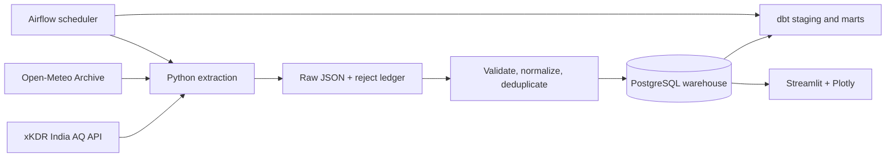

# Urban Air Quality Intelligence Platform

An end-to-end, real-data ETL and analytics project for air quality and weather. The xKDR India Air Quality API supplies CPCB and US Embassy monitoring observations; Open-Meteo supplies gridded historical weather context. No bundled or fabricated readings are used.

## Architecture



## Data sources and limitations

* **xKDR India Air Quality API**: `https://airquality.xkdr.org`. It serves hourly CPCB CAAQM and US Embassy monitor data through city-filtered JSON/CSV/Parquet queries and monthly Parquet files. Get a free personal key at [xKDR key signup](https://airquality.xkdr.org/signup); the personal key has no rate or row cap. The public demo key is limited to 2024 and 10,000 rows/query. The API's published history and station freshness vary by city; the pipeline queries each city's station metadata and anchors its seven-day window to the latest station timestamp, rather than inventing current readings. Dates from xKDR are IST and are converted to UTC. Units are normalized to µg/m³; unsupported units are written to the rejection ledger. See the [xKDR API reference](https://github.com/xKDR/Air-Quality-Database/blob/main/docs/PUBLIC_API.md).
* **Open-Meteo Historical Weather API**: `https://archive-api.open-meteo.com/v1/archive`; hourly reanalysis is globally available from 1940 (dataset/resolution dependent), with temperature, humidity, wind, precipitation, and WMO weather code. Public non-commercial use needs no key; commercial reserved resources require an API key. Weather is a modeled grid-cell estimate, not a station observation. See the [official historical API docs](https://open-meteo.com/en/docs/historical-weather-api).
* Network/API access is required for ingestion. City/station metadata and coordinates are read from xKDR; the configured city coordinates are only used to request weather. A city with no returned stations or measurements is reported as unavailable.

## Warehouse

Dimensions: `dim_city`, `dim_station`, `dim_date`, `dim_pollutant`. Facts: `fact_air_quality` (one station/pollutant observation at a timestamp) and `fact_weather` (one city/grid-cell hourly record). Natural source identifiers and unique constraints make loads idempotent. Raw responses and rejected records are persisted for lineage and debugging. Indexes cover time, city and pollutant filters.

## Run locally

1. Copy `.env.example` to `.env`, set `XKDR_API_KEY` from your free personal key, and review the city list/lookback window.
2. Run `docker compose up --build -d`. Services: PostgreSQL, one-shot initialization, Airflow webserver/scheduler, and Streamlit.
3. Visit Streamlit at `http://localhost:8501`, Airflow at `http://localhost:8080` (default local credentials `airflow`/`airflow`). Trigger `urban_air_quality_etl` manually or wait for its daily schedule.
4. Or use a Python environment: `pip install -r requirements.txt`; set `DATABASE_URL` and `XKDR_API_KEY`; run `python -m src.pipeline`.

The bootstrap SQL initializes warehouse tables. Airflow retries transient API failures. API failures are surfaced in task logs and the run ledger; a city with zero stations/measurements is recorded as unavailable, not treated as real readings. Keep `.env` private.

### Native Windows without Docker

Use this route if you do not want Docker Desktop/WSL virtualization. Install PostgreSQL for Windows and create a database named `airquality` plus a login named `airquality` using the password in `.env` (default template value: `airquality`). Change the local `DATABASE_URL` host to `localhost` if needed. Then, in PowerShell from this directory:

```powershell
python -m venv .venv
.\.venv\Scripts\python.exe -m pip install -r requirements-windows.txt
.\run-pipeline.ps1
```

In a second PowerShell window, run `.\run-dashboard.ps1` and open `http://localhost:8501`. To schedule ingestion, create a Windows Task Scheduler task that runs `powershell.exe` with arguments `-NoProfile -ExecutionPolicy Bypass -File "<project-path>\run-pipeline.ps1"` and set its Start in directory to the project folder. This mode runs the real Python ETL, PostgreSQL warehouse, dbt, and Streamlit directly on Windows; it substitutes Task Scheduler for Airflow. Apache Airflow itself requires WSL2/Linux containers on Windows, as documented by the [Airflow installation guide](https://airflow.apache.org/docs/apache-airflow/2.10.0/installation/prerequisites.html).

## ETL stages

1. Discover configured city stations and their latest available timestamps; calculate each city's incremental date window.
2. Fetch all configured pollutants per city in a city-filtered query, plus hourly weather. Persist each response in `raw_api_response` with source, city and retrieval time.
3. Validate station identifiers, numeric values, timestamps, pollutant labels and units. Preserve rejected rows in `rejected_record` with reason and source payload.
4. Convert xKDR's naive IST timestamps to UTC, normalize pollutant labels/units, and deduplicate by station, pollutant and timestamp.
5. Upsert dimensions and facts within transactions; record counts and run status in `pipeline_run`.
6. dbt builds hourly/daily summaries and runs schema/data tests. The dashboard queries warehouse facts and computed marts only.

## Operations and configuration

See `.env.example` for all settings. `CITIES` accepts comma-separated names, `LOOKBACK_HOURS` sets the initial and incremental window, and `SCHEDULE_CRON` controls the DAG schedule. The pipeline stores a watermark per city/source and re-reads a small overlap to account for delayed records. PostgreSQL uniqueness constraints prevent duplicate facts on reruns. xKDR queries have a 90-second timeout; response truncation is detected and fails loudly so no rows are silently missed.

## Development

```bash
python -m pytest
dbt deps --project-dir dbt
dbt build --project-dir dbt --profiles-dir dbt
```

CI runs pytest and Python compilation. Tests use synthetic *unit-test fixtures only* and never seed dashboard/warehouse metrics. To create portfolio screenshots, start the stack after successful live extraction; the dashboard will show an availability notice until real observations load.

## Known limitations / next steps

xKDR is a periodically published historical compilation, not a live feed; the latest available readings vary by station and city. Weather is sampled at city coordinates and joined by hour, so it does not represent station microclimates. Current anomalies are a transparent rule-based high-reading flag; this is not a regulatory alert. For production deployment, add secret management, TLS, retention policies, alert routing, and stronger access controls.
